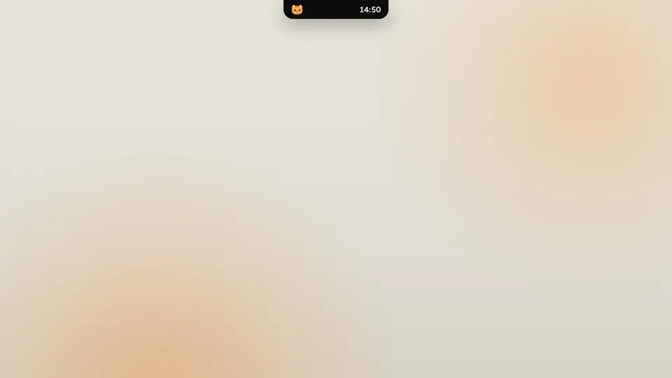
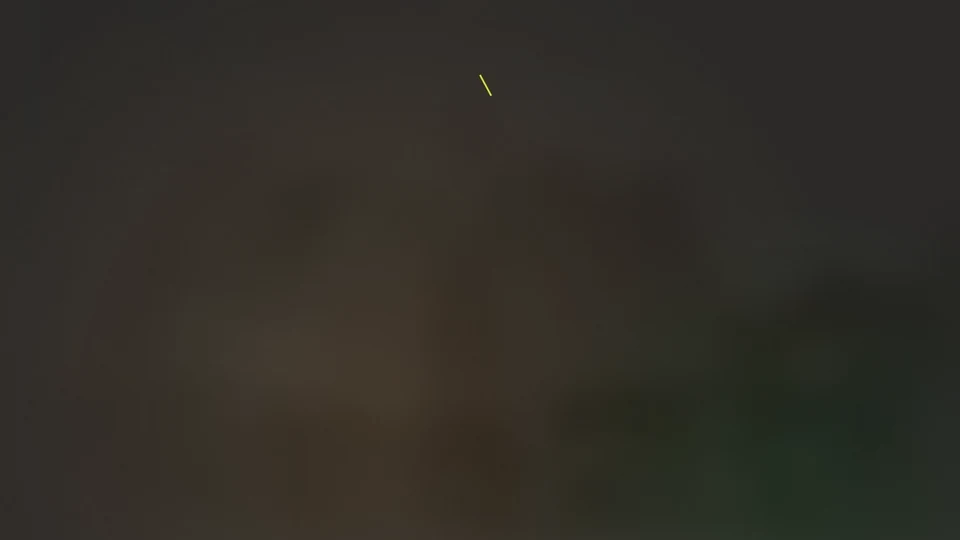

<p align="center">
  
</p>

<p align="center">
  
</p>

<p align="center">
  
  <a href="https://github.com/Uniclowns?tab=followers"></a>
  
</p>



## About me


```ts
const pete = {
  name: "Pheterson Ferry Fernando",
  location: "Pontianak, West Kalimantan",
  builds: ["web", "mobile", "desktop"],
  agency: "Luma Digital Creative",
  shipped: ["Cikung", "gkkbpontianak.org"],
};
```

<br clear="right">


## Portfolio

### Cikung



**Rust, egui** · Windows and Mac<br>A small orange cat that lives in the notch at the top of your screen. It shows the song you're playing with synced lyrics, keeps a timer and notes close by, and tells you when an AI agent finishes its work.

<!-- CIKUNG_BUTTON: add a link here once there is a public download page. -->

### Website GKKB Jemaat Pontianak

<a href="https://gkkbpontianak.org"></a>

**Next.js, Tailwind CSS**<br>The church website for GKKB Jemaat Pontianak.

<a href="https://gkkbpontianak.org"></a>


## Tools I use

<p align="left">
  
</p>


## Activity

<p align="center">
  
</p>

<picture>
  <source media="(prefers-color-scheme: dark)" srcset="https://raw.githubusercontent.com/Uniclowns/Uniclowns/output/github-snake-dark.svg">
  <source media="(prefers-color-scheme: light)" srcset="https://raw.githubusercontent.com/Uniclowns/Uniclowns/output/github-snake.svg">
  
</picture>

<!--
## Elsewhere

Replace USERNAME and remove these comment markers to show the buttons.

<a href="https://instagram.com/USERNAME"></a>
<a href="https://www.linkedin.com/in/USERNAME"></a>
-->
